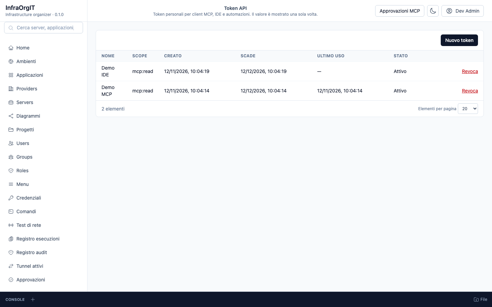
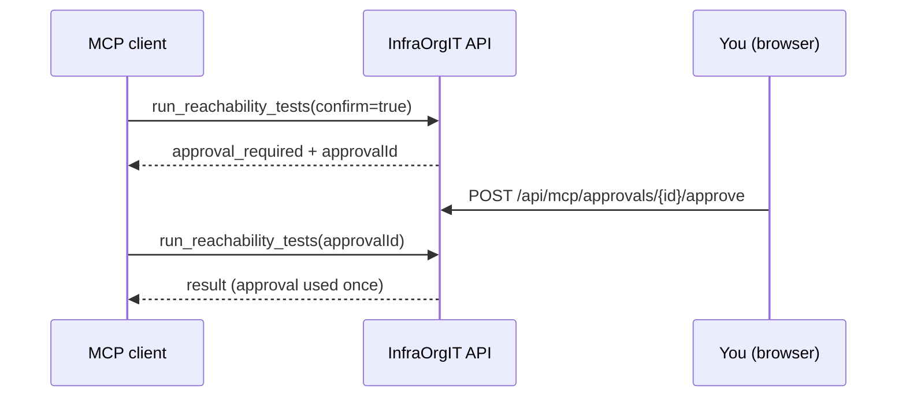
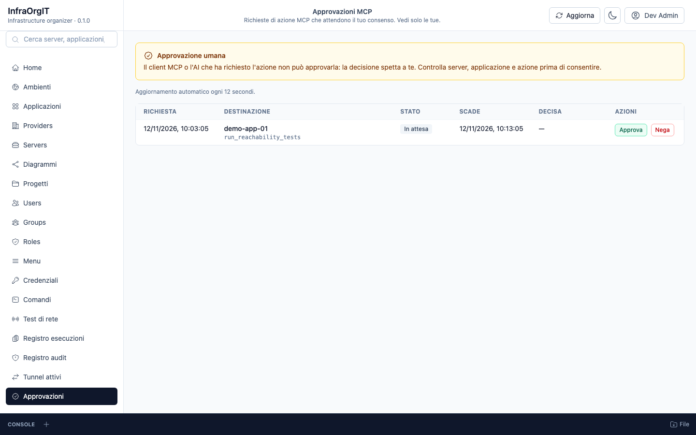

# InfraOrgIT API

InfraOrgIT API is the backend and MCP server of InfraOrgIT. It owns the
inventory model, permissions, credentials, SSH/SFTP operations, audit log and
the tools an AI client can call.

The API has no separate user interface: the pages shown below are served by
[InfraOrgIT Web](https://github.com/SenseiKiritof/InfraOrgITWeb). Screenshots
use fictitious demo data.

## What it does

- **Inventory**: providers, environments, servers, applications, versions,
  deployments, proxy routes and projects, with the relationships the diagram
  and the project pages use.
- **Access control**: Keycloak login through the backend-for-frontend,
  `SystemAdmin` master data, `ServerAdmin`/`ServerOperator` per environment and
  a generated OpenAPI contract.
- **Remote operations**: SSH console, SFTP/FTPS file transfer, command
  templates, application actions and network reachability tests executed from
  the server.
- **MCP**: inventory tools, resources and prompts over `/mcp` (Streamable
  HTTP), for IDE assistants and agents.
- **Desktop tunnels**: the tunnel API accepts the authenticated BFF session as
  well as a personal token with `tunnels:operate`, so the desktop reuses the
  Web login.
- **Connection policy**: a per-installation `Server`/`Client`/`Auto` row in
  MySQL, default `Auto`; `Server` keeps console/files/actions on the API and
  relays allowlisted Local tunnels and deployments, while `Auto` uses the
  client when the first SSH hop is reachable and falls back to the server
  otherwise. `Client` uses the desktop agent for all four. The row is shared by
  every API node in a cluster. `GET /api/connection-policy` accepts the BFF
  session or a `tunnels:operate` token; `PUT` is SystemAdmin-only. Direct
  console/actions are projected to `CommandExecutions`, file operations to the
  `FileTransfer` audit kind.
- **Human approval**: an MCP action requested by an AI client needs a human
  decision before it runs.
- **Audit**: MCP calls, console sessions, actions, tests and tunnel events,
  with a tamper-evident hash chain and an optional external anchor.

## Connect an MCP client

1. Sign in to the web app and create a personal token from the user menu
   (`/tokens`). Choose `mcp:read` for read-only clients or
   `mcp:read mcp:operate` when the client must request actions. The token is
   shown once.
2. Point the MCP client at `https://<your-instance>/mcp` and send the token as
   a bearer token. OAuth clients can discover the resource metadata at
   `/.well-known/oauth-protected-resource` and use Keycloak for authorization
   instead of a personal token.
3. Read tools and resources work immediately. Action tools also need an
   `McpGrant` for the user or group, the environment operator right and human
   approval.



### Action approval

`confirm=true` is not a human confirmation. The action tools
`run_reachability_tests` and `run_application_action`:

1. check scope, MCP grant and environment role;
2. create a **Pending** approval bound to the user, action, server, target and
   parameters, and return `{ "status": "approval_required", "approvalId": … }`;
3. wait for the owner to approve or deny the request from `/approvals` in a
   browser session (cookie + CSRF, one-time, 10 minutes);
4. execute only when called again with the approved `approvalId`.



`get_mcp_approval` returns the status and expiry of a request without executing
it, so a client can poll instead of retrying the action.

## Desktop sign-in

InfraOrgIT Desktop prefers the BFF session already present in the instance tab.
Only when no web session is available does it use the Keycloak device flow on
the public client `infraorgit-mcp-desktop` (no client secret), then exchange the
refresh token for a BFF cookie:

- `POST /auth/desktop-session` is anonymous and rate-limited per client IP.
  The body is `{ "refreshToken": "..." }`; the API redeems it at Keycloak with
  the public desktop client, validates the returned `id_token`, provisions the
  user and sets the usual HttpOnly session cookie. It returns `204`.
- An invalid, expired or revoked refresh token returns `401`
  `desktop_session_invalid`; an unreachable or failing Keycloak returns `502`
  `oidc_error`. Arbitrary access tokens are never accepted and `id_token`
  signature, issuer, audience and lifetime are always validated.
- The rotated refresh token stays server-side in the encrypted session; it is
  never returned to the caller or written to logs. The BFF session lives for
  `Auth:DesktopSessionDays` (default 7, valid 1..90), independently of the
  shorter Keycloak refresh-token lifetime. Calling the endpoint again with the
  same desktop cookie extends that same session, so the desktop can renew it
  periodically without creating orphan sessions.
- `Oidc:DesktopClientId` defaults to `infraorgit-mcp-desktop` and must match the
  public Keycloak client; the confidential BFF client is not used for this
  exchange.

## Session theme

- `GET /api/session` returns `theme` (`light`, `dark` or `system`).
- `PATCH /api/session/theme` requires the `Session` policy plus CSRF and Origin,
  accepts `{ "theme": "light|dark|system" }` and returns `204`.
- The preference is stored per user in `Users.Theme`; existing users default to
  `system`.

## Desktop downloads

The current Electron client uses Chromium's native download for server
attachments and its blob bridge for generated API results; there is no desktop
download-mode setting. The signed-ticket endpoints below remain for API
compatibility, but the Electron client does not use them:

- `GET /api/desktop/downloads/capabilities` reports whether signed URLs are
  enabled.
- `POST /api/desktop/downloads/tickets` creates a short-lived ticket bound to
  the current user, server and path. It accepts only a cookie session with
  CSRF; an API token cannot create tickets.
- `GET /api/desktop/downloads/{token}` is anonymous by design because the
  ticket is the credential. It is one-time, expires, streams the file without
  holding a lock, and is audited.

Set `DesktopDownloads:Enabled=false` to disable new tickets and invalidate
already-issued ones; `TicketLifetimeSeconds` defaults to 120 and
`PublicBaseUrl` is needed only behind a proxy with a different origin.

Tickets are metadata only: user, server, normalized path and timestamps; the
raw token and file content are never stored. For GDPR storage limitation,
`DesktopDownloads:RetentionDays` defaults to 30 and a background job deletes
expired ticket rows past that window (consumed or not).
`DesktopDownloads:CleanupIntervalMinutes` defaults to 1440 and the first pass
runs shortly after startup. Audit rows keep their separate 180-day retention
policy.



## Run the API

The supported way to run the whole product is the published-image stack in
[AllInfraOrgIT](https://github.com/SenseiKiritof/AllInfraOrgIT):

```bash
git clone https://github.com/SenseiKiritof/AllInfraOrgIT.git
cd AllInfraOrgIT
cp deploy/.env.example deploy/.env   # replace the CHANGE_ME_* secrets and image tags
deploy/scripts/check-env.sh deploy/.env
make up-images
```

The API image runs the EF migrations. For local development with source,
Hot reload and the test suite, see [`docs/DEVELOPMENT.md`](docs/DEVELOPMENT.md).

## API contract

The executable OpenAPI contract is
[`openapi/InfraOrgIt.Api.json`](openapi/InfraOrgIt.Api.json) (OpenAPI 3.1.1).
It is generated from the code; CI fails if it drifts. The domain draft and the
route inventory are in
[`../AllInfraOrgIT/docs/api`](../AllInfraOrgIT/docs/api).

## Learn more

- [InfraOrgIT Web](https://github.com/SenseiKiritof/InfraOrgITWeb) — the user
  interface.
- [`../AllInfraOrgIT/docs/security/permissions.md`](../AllInfraOrgIT/docs/security/permissions.md)
  — roles and environment permissions.
- [`../AllInfraOrgIT/docs/operations/mcp-tunnel-hardening.md`](../AllInfraOrgIT/docs/operations/mcp-tunnel-hardening.md)
  — MCP and tunnel hardening.
- [`docs/DEVELOPMENT.md`](docs/DEVELOPMENT.md) — stack, structure, commands,
  configuration, migrations, credential rewrap, security internals and
  observability.
