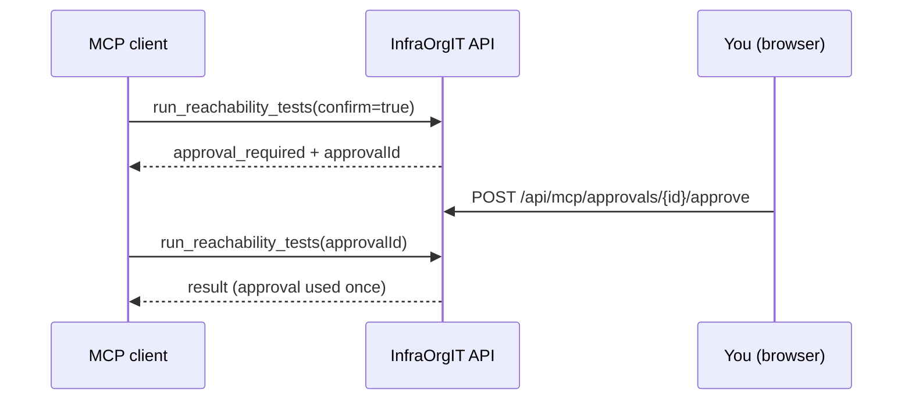

# InfraOrgIT API

InfraOrgIT API is the backend and MCP server of InfraOrgIT. It owns the
inventory model, permissions, credentials, SSH/SFTP operations, audit log and
the tools an AI client can call.

The API has no separate user interface: the pages shown below are served by
[InfraOrgIT Web](https://github.com/SenseiKiritof/InfraOrgITWeb). Screenshots
use fictitious demo data.

## What it does

- **Inventory**: providers, environments, servers, applications, versions,
  deployments, proxy routes and projects, with the relationships the diagram
  and the project pages use.
- **Access control**: Keycloak login through the backend-for-frontend,
  `SystemAdmin` master data, `ServerAdmin`/`ServerOperator` per environment and
  a generated OpenAPI contract.
- **Remote operations**: SSH console, SFTP/FTPS file transfer, command
  templates, application actions and network reachability tests executed from
  the server.
- **MCP**: inventory tools, resources and prompts over `/mcp` (Streamable
  HTTP), for IDE assistants and agents.
- **Human approval**: an MCP action requested by an AI client needs a human
  decision before it runs.
- **Audit**: MCP calls, console sessions, actions, tests and tunnel events,
  with a tamper-evident hash chain and an optional external anchor.

## Connect an MCP client

1. Sign in to the web app and create a personal token from the user menu
   (`/tokens`). Choose `mcp:read` for read-only clients or
   `mcp:read mcp:operate` when the client must request actions. The token is
   shown once.
2. Point the MCP client at `https://<your-instance>/mcp` and send the token as
   a bearer token. OAuth clients can discover the resource metadata at
   `/.well-known/oauth-protected-resource` and use Keycloak for authorization
   instead of a personal token.
3. Read tools and resources work immediately. Action tools also need an
   `McpGrant` for the user or group, the environment operator right and human
   approval.


### Action approval

`confirm=true` is not a human confirmation. The action tools
`run_reachability_tests` and `run_application_action`:

1. check scope, MCP grant and environment role;
2. create a **Pending** approval bound to the user, action, server, target and
   parameters, and return `{ "status": "approval_required", "approvalId": … }`;
3. wait for the owner to approve or deny the request from `/approvals` in a
   browser session (cookie + CSRF, one-time, 10 minutes);
4. execute only when called again with the approved `approvalId`.



`get_mcp_approval` returns the status and expiry of a request without executing
it, so a client can poll instead of retrying the action.


## Run the API

The supported way to run the whole product is the published-image stack in
[AllInfraOrgIT](https://github.com/SenseiKiritof/AllInfraOrgIT):

```bash
git clone https://github.com/SenseiKiritof/AllInfraOrgIT.git
cd AllInfraOrgIT
cp deploy/.env.example deploy/.env   # replace the CHANGE_ME_* secrets and image tags
deploy/scripts/check-env.sh deploy/.env
make up-images
```

The API image runs the EF migrations. For local development with source,
Hot reload and the test suite, see [`docs/DEVELOPMENT.md`](docs/DEVELOPMENT.md).

## API contract

The executable OpenAPI contract is
[`openapi/InfraOrgIt.Api.json`](openapi/InfraOrgIt.Api.json) (OpenAPI 3.1.1).
It is generated from the code; CI fails if it drifts. The domain draft and the
route inventory are in
[`../AllInfraOrgIT/docs/api`](../AllInfraOrgIT/docs/api).

## Learn more

- [InfraOrgIT Web](https://github.com/SenseiKiritof/InfraOrgITWeb) — the user
  interface.
- [`../AllInfraOrgIT/docs/security/permissions.md`](../AllInfraOrgIT/docs/security/permissions.md)
  — roles and environment permissions.
- [`../AllInfraOrgIT/docs/operations/mcp-tunnel-hardening.md`](../AllInfraOrgIT/docs/operations/mcp-tunnel-hardening.md)
  — MCP and tunnel hardening.
- [`docs/DEVELOPMENT.md`](docs/DEVELOPMENT.md) — stack, structure, commands,
  configuration, migrations, credential rewrap, security internals and
  observability.
